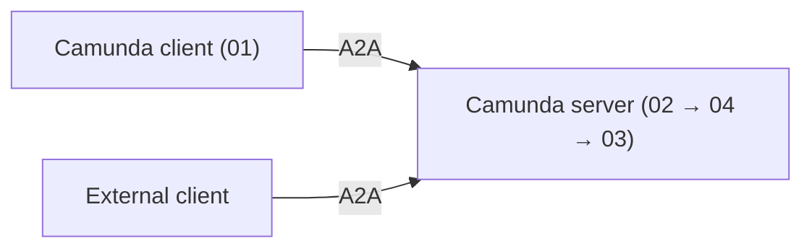

# A2A blueprint

Let your Camunda agents talk to other agents, and let other agents call yours, using the
[Agent2Agent (A2A)](https://a2a-protocol.org) protocol on Camunda 8.9 or later.

In this example, a client agent asks a server agent to run one tool, `upperCase`. The tool returns
the request data, an uppercased copy, and its length. Replace it with your own logic to build a real
A2A agent.

The server uses the standard webhook connector with two A2A element templates
(`.camunda/element-templates/`), so it runs on the released Camunda 8.9 connectors runtime. You don't
need a custom connector or job worker.

| Process                 | Role                                                                            |
| ----------------------- | ------------------------------------------------------------------------------- |
| `01` `a2a-client`       | Client agent. An AI agent that uses the **A2A Client connector** as its tool.   |
| `02` `a2a-rpc`          | A2A server endpoint. Camunda has no native A2A server connector, so this is BPMN. |
| `03` `a2a-server-agent` | Server agent. An AI agent with one tool, `upperCase`.                           |
| `04` `a2a-task`         | Tracks each task: its state, cancellation, and optional push notification.      |



## Before you start

Tested on Camunda 8.9.26 with Connectors 8.9.17 and Java 21. The Maven scenarios in `test/` use
Camunda Process Test 8.9.8.

1. Use a Camunda 8.9 SaaS cluster (or a self-managed 8.9 cluster with the connector runtime).
2. Create an API client with the **Zeebe** scope (Console → Cluster → API) and add these cluster
   secrets. The values below are placeholders to copy and replace:

| Secret                                                                                                    | Value                                                                       |
| --------------------------------------------------------------------------------------------------------- | --------------------------------------------------------------------------- |
| `ENGINE_URL`                                                                                              | Cluster REST address, for example `https://bru-2.zeebe.camunda.io/<cluster-id>`, without `/v2` |
| `ENGINE_CLIENT_ID`, `ENGINE_CLIENT_SECRET`                                                                | The API client credentials                                                  |
| `A2A_AGENT_PROCESS`                                                                                       | `a2a-server-agent` (the process the server runs for each task)              |
| `A2A_CALLBACK_URL`                                                                                        | `<connectors-url>/inbound/a2a-client-callback` (the client's callback URL)  |
| `A2A_CALLBACK_TOKEN`                                                                                      | A random string you choose. The server sends it as a Bearer token and the callback endpoint rejects calls without it. |
| `CAMUNDA_PROVIDED_LLM_API_ENDPOINT`, `CAMUNDA_PROVIDED_LLM_API_KEY`, `CAMUNDA_PROVIDED_LLM_DEFAULT_MODEL` | LLM access for the AI agents                                                |

   On self-managed without OAuth, change the `authentication.*` inputs of the HTTP JSON tasks in
   `02` to your cluster's auth type.

3. In `02-a2a-server.bpmn`, select the `Agent Card requested` start event and set **Public RPC URL**
   (`inbound.publicRpcUrl`) to `<connectors-url>/inbound/a2a`. It must use HTTPS. In SaaS, `<connectors-url>` is the connector
   runtime URL of your cluster.
4. Deploy `02`, `03`, `04`, and `server-request-validation.dmn`.
5. Open `<connectors-url>/inbound/a2a-card` in a browser. You should see the Agent Card as JSON.

## Example 1: Camunda client, Camunda server

1. Set the secret `A2A_REMOTE_SERVER_URL` to `<connectors-url>/inbound/a2a-card` and restart the
   connector runtime.
2. Deploy `01-client-agent.bpmn` and start `a2a-client`. It sends `demoInput` as
   `{"value": "Example input"}`.
3. In Operate, check that:
   - the client AI agent calls `fetchAgentCard`, then `sendMessage`, which returns a submitted Task
     right away (it does not wait for the work);
   - the server side runs one `a2a-task` instance and one `a2a-server-agent` instance;
   - `Result callback received` completes when the server calls back, and the client reports
     `{"received": {"value": "Example input"}, "uppercase": "EXAMPLE INPUT", "length": 13}`.

## Example 2: external client, Camunda server

Any A2A client works. This example uses `curl` with an A2A 0.3 request. A2A 1.0 requests also work.

```bash
curl -s -X POST "<connectors-url>/inbound/a2a" -H 'Content-Type: application/json' -d '{
  "jsonrpc": "2.0", "id": 1, "method": "message/send",
  "params": {"message": {
    "kind": "message", "messageId": "m1", "role": "user",
    "parts": [{"kind": "data", "data": {"demoInput": {"value": "Example input"}}}]
  }}
}'
```

The response is a Task whose `placeholder` artifact holds the same result as in Example 1. To fetch
the Task again, send `{"method": "tasks/get", "params": {"id": "<task id>"}}`.

Your client can send `demoInput` as a `data` part or as JSON in a `text` part. To try a full client,
use the Google ADK client in [`adk/`](adk/README.md) and point it at the Agent Card URL.

## How it works

- **Client (01).** `sendMessage` runs in `notification` mode. It returns the Task immediately and
  registers `A2A_CALLBACK_URL` with a Bearer token. The *A2A Client Webhook* catch event
  (`Result callback received`) accepts only calls with that token, correlates on task id and
  notification token, ignores non-final states, and drops duplicate deliveries. If no callback
  arrives within 10 minutes, the tool call ends with a `timeout` result.
- **Server (02).** Validates the request, starts `a2a-task` (04), and waits for its settled signal
  (`a2a-settled:<taskId>:<rev>`). `SendMessage`, `GetTask`, and `CancelTask` answer from the settled
  Task.
- **Task (04).** Part of the one A2A server: it has no endpoint of its own and is started only by 02. Calls the server agent (03), maps failures and cancellations to the Task state, and
  builds the next Task revision. If the client sent a push configuration, it also POSTs the Task to
  that URL with the Bearer credentials and the notification token. Standalone push-configuration methods return `UNSUPPORTED_OPERATION`, so send the
  configuration inline in `SendMessage`.
- **Agent (03).** Reads `demoInput` from the request (from the data part, otherwise from JSON text)
  and passes it to `upperCase` through `fromAi()`.

**A2A versions.** The Camunda client connector speaks A2A 0.3, so 02 serves both 0.3 and 1.0 on one
endpoint with one Agent Card. It converts requests to the 1.0 format and answers each caller, including
push notifications, in the caller's own version. In 0.3, `tasks/list`, streaming, and standalone
push-configuration methods are not supported.

## Contents

- `01-client-agent.bpmn`: client agent that uses the A2A Client connector.
- `02-a2a-server.bpmn`: the A2A server (`a2a-rpc`). It uses OAuth client credentials for Camunda API calls.
- `03-server-agent.bpmn`: server agent with a placeholder script tool, `upperCase`.
- `04-a2a-task.bpmn`: per-task logic for the server (`a2a-task`).
- `server-request-validation.dmn`: checks that incoming requests are valid A2A requests.
- `.camunda/element-templates/`: the two A2A element templates (server endpoint and Agent Card).
  Camunda Desktop Modeler loads them from this folder. The HTTP JSON v13 and AI Agent v5 templates
  are built in, so they are not included.
- `*.test.json`: Test Studio scenarios, one file per process (`01` to `04`). `01` has the Example 1
  end-to-end scenario, and `02` has the Example 2 scenario.
- `test/`: Maven project that runs the scenarios with Camunda Process Test, plus `FeelCasesTest` for
  the FEEL outcome mapping in `04`.
- `adk/`: an external A2A agent built with Google ADK, used to check interoperability.

## Run the tests

```bash
mvn test -f test/pom.xml                      # Camunda Process Test: 50 tests, no cluster or LLM needed
cd adk && .venv/bin/python -m pytest          # offline ADK interop tests (see adk/README.md)
```

The Maven suite runs in CI (`test-suites.yml`). The ADK tests do not. Camunda Process Test reports
process coverage per class. The server (`a2a-rpc`) reaches about 97% in `ServerScenariosTest`. The
uncovered elements are the webhook start events (`RpcReceived`, `CardRequested`), which Test Studio
cannot use as start instructions. Test Studio scenarios cover the BPMN paths. The Java tests cover
regression behavior.

This solution has no forms. Deploy only one server profile.

## Import into Camunda SaaS

[Import all resources into Web Modeler](https://modeler.cloud.camunda.io/import/resources?source=https://raw.githubusercontent.com/camunda/camunda-8-tutorials/refs/heads/main/solutions/a2a-async-blueprint/01-client-agent.bpmn,https://raw.githubusercontent.com/camunda/camunda-8-tutorials/refs/heads/main/solutions/a2a-async-blueprint/02-a2a-server.bpmn,https://raw.githubusercontent.com/camunda/camunda-8-tutorials/refs/heads/main/solutions/a2a-async-blueprint/03-server-agent.bpmn,https://raw.githubusercontent.com/camunda/camunda-8-tutorials/refs/heads/main/solutions/a2a-async-blueprint/04-a2a-task.bpmn,https://raw.githubusercontent.com/camunda/camunda-8-tutorials/refs/heads/main/solutions/a2a-async-blueprint/server-request-validation.dmn,https://raw.githubusercontent.com/camunda/camunda-8-tutorials/refs/heads/main/solutions/a2a-async-blueprint/.camunda/element-templates/server-a2a-rpc-endpoint.json,https://raw.githubusercontent.com/camunda/camunda-8-tutorials/refs/heads/main/solutions/a2a-async-blueprint/.camunda/element-templates/server-agent-card-endpoint.json,https://raw.githubusercontent.com/camunda/camunda-8-tutorials/refs/heads/main/solutions/a2a-async-blueprint/01-client-agent.test.json,https://raw.githubusercontent.com/camunda/camunda-8-tutorials/refs/heads/main/solutions/a2a-async-blueprint/02-a2a-server.test.json,https://raw.githubusercontent.com/camunda/camunda-8-tutorials/refs/heads/main/solutions/a2a-async-blueprint/03-server-agent.test.json,https://raw.githubusercontent.com/camunda/camunda-8-tutorials/refs/heads/main/solutions/a2a-async-blueprint/04-a2a-task.test.json,https://raw.githubusercontent.com/camunda/camunda-8-tutorials/refs/heads/main/solutions/a2a-async-blueprint/README.md&title=A2A%20Async%20Blueprint)

The link loads the files from `main`, so it works only after this solution is merged there. It imports the BPMN and DMN files, the two element templates, the tests, and this README.

## Customization

To build your own agent, replace `upperCase` in `03` with your own logic. `04` returns the tool
result as the `placeholder` artifact, so update it there if your result has a different shape. Also
update the name, description, and skills in the Agent Card on `02`.

## Known gaps

- Callback authentication, duplicate suppression and non-final-state filtering are enforced by the
  inbound connector, so Camunda Process Test can't exercise them. The tests cover correlation,
  duplicate delivery after completion, the timeout, and the server's authenticated push request.
  Push retries stop at the HTTP connector's three attempts.
- The Maven suite takes about two minutes, mostly embedded-engine startup per test class.
- The A2A Client connector can't run in Camunda Process Test. The Example 1 scenario completes its
  jobs with mocked results. The Example 2 scenario runs 02, 03, and 04 together.
- Every agent and connector response is mocked or scripted in the Maven suite. No test checks real
  LLM behavior, the real A2A Client or inbound connectors, or the Agent Card endpoint.
- The ADK interop tests run only locally, not in CI, and the Camunda-server variant needs
  `CAMUNDA_CARD_URL` pointing at a live deployment.
- Process 01 can't resume a multi-turn conversation (a Task in the `input-required` state).
