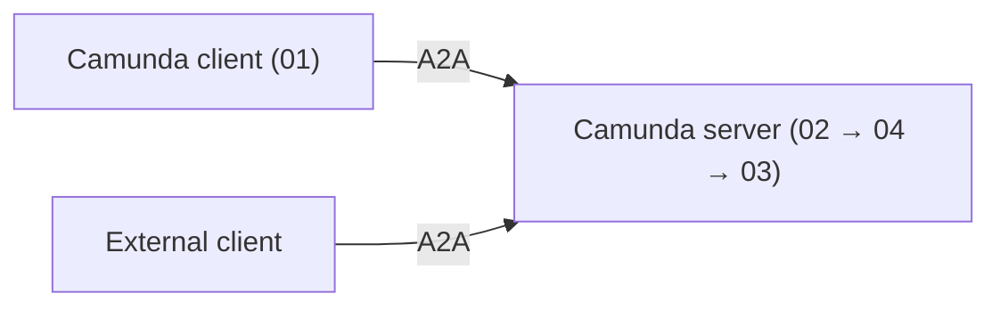

# A2A blueprint

An [Agent2Agent (A2A)](https://a2a-protocol.org) example for Camunda 8.9+. A client agent asks a
server agent to run a tool (`upperCase`), which returns the request data plus an uppercased copy
and its length.

The server side is built from A2A element templates (`.camunda/element-templates/`) on the inbound
webhook, so it runs on the released Camunda 8.9 connectors runtime. No custom connector or worker is
needed.

| Process                 | What it is                                                                      |
| ----------------------- | ------------------------------------------------------------------------------- |
| `01` `a2a-client`       | Client agent. An AI agent with the native **A2A Client connector** as its tool. |
| `02` `a2a-rpc`          | The A2A server endpoint (custom BPMN, no native server connector exists).       |
| `03` `a2a-card-dispute` | Server agent. An AI agent with one tool, `upperCase`.                           |
| `04` `a2a-task`         | Per-task protocol logic: task state, cancel, optional push notification.        |



## Before you start

Run end to end on Camunda 8.9.26 with Connectors 8.9.17 and Java 21. The Maven scenarios in
`test/` run on Camunda Process Test 8.9.8.

1. Run Camunda 8.9+ with the connector runtime (for example `c8ctl cluster start`).
2. Set these connector secrets, then restart the connector runtime:

| Secret                                                                                                    | Value                                                             |
| --------------------------------------------------------------------------------------------------------- | ----------------------------------------------------------------- |
| `ENGINE_URL`                                                                                              | Engine REST URL as seen from the connector runtime, without `/v2` |
| `ENGINE_USERNAME`, `ENGINE_PASSWORD`                                                                      | Basic auth for platform calls                                     |
| `A2A_AGENT_PROCESS`                                                                                       | `a2a-card-dispute`                                                |
| `CAMUNDA_PROVIDED_LLM_API_ENDPOINT`, `CAMUNDA_PROVIDED_LLM_API_KEY`, `CAMUNDA_PROVIDED_LLM_DEFAULT_MODEL` | LLM for the AI agents                                             |

3. In `02-a2a-server.bpmn`, set `inbound.publicRpcUrl` on `CardRequested` to
   `<connectors-url>/inbound/a2a` (HTTPS is required).
4. Deploy `02`, `03`, `04` and `server-request-validation.dmn`.
5. Open `<connectors-url>/inbound/a2a-card` and check that the Agent Card loads.

## Example 1: Camunda client, Camunda server

1. Set the secret `A2A_REMOTE_SERVER_URL` to `<connectors-url>/inbound/a2a-card` and restart the
   connector runtime.
2. Deploy `01-client-agent.bpmn` and start `a2a-client`. It sends `demoInput` =
   `{"value": "Example input"}`.
3. In Operate, expect:
   - the client AI agent calls `fetchAgentCard`, then `sendMessage`;
   - one `a2a-task` and one `a2a-card-dispute` instance on the server side;
   - `Remote task settled` finishes, and the client reports
     `{"received": {"value": "Example input"}, "uppercase": "EXAMPLE INPUT", "length": 13}`.

## Example 2: external client, Camunda server

Any A2A client works. This one uses plain `curl` (A2A 0.3 shown; 1.0 also works).

```bash
curl -s -X POST "<connectors-url>/inbound/a2a" -H 'Content-Type: application/json' -d '{
  "jsonrpc": "2.0", "id": 1, "method": "message/send",
  "params": {"message": {
    "kind": "message", "messageId": "m1", "role": "user",
    "parts": [{"kind": "data", "data": {"demoInput": {"value": "Example input"}}}]
  }}
}'
```

Expect a Task whose artifact `placeholder` holds the transformed data from the example above. Fetch
it again with `{"method": "tasks/get", "params": {"id": "<task id>"}}`.

Your client can send `demoInput` as a `data` part or as JSON text in a `text` part. To try a real
client, use the Google ADK one in [`adk/`](adk/README.md), pointed at the Agent Card URL.

## How it works

- **Client (01).** The connector's `sendMessage` runs in polling mode: it returns the Task and the
  `Remote task settled` catch event polls until the Task is final. Push (`notification`) mode needs
  the connector webhook URL and token and the *A2A Client Webhook* catch event instead.
- **Server (02).** Validates the request, starts `a2a-task` (04) and waits for its settled signal
  (`a2a-settled:<taskId>:<rev>`). `SendMessage`, `GetTask` and `CancelTask` answer from the settled
  Task.
- **Task (04).** Calls the business agent (03), maps failure and cancel to the Task state, and builds
  the next Task revision. If the client sent a push config, it also POSTs the Task there. Standalone
  push-config methods return `UNSUPPORTED_OPERATION`; send the config inline in `SendMessage`.
- **Agent (03).** Reads `demoInput` from the request (data part, else JSON text) and passes it to
  `upperCase` through `fromAi()`.

**Dialects.** The Camunda client connector speaks A2A 0.3, so 02 serves 0.3 and 1.0 on one endpoint
and one Agent Card. Requests are normalized to the 1.0 model; responses and push use the caller's
dialect. Not covered in 0.3: `tasks/list`, streaming and standalone push-config methods.

## Contents

| Resource                            | Purpose                                                                                                                                                                                        |
| ----------------------------------- | ---------------------------------------------------------------------------------------------------------------------------------------------------------------------------------------------- |
| `01-client-agent.bpmn`              | Client agent using the native A2A Client connector                                                                                                                                             |
| `02-a2a-server.bpmn`                | The single executable A2A server (`a2a-rpc`), Basic-auth platform calls                                                                                                                        |
| `03-server-agent-card-dispute.bpmn` | Server agent with a placeholder script tool (`upperCase`)                                                                                                                                      |
| `04-a2a-task.bpmn`                  | Per-task server protocol (`a2a-task`)                                                                                                                                                          |
| `adk/`                              | External A2A agent (Google ADK) used to check interoperability                                                                                                                                 |
| `server-request-validation.dmn`     | Protocol request validation                                                                                                                                                                    |
| `.camunda/element-templates/`       | Custom A2A element templates (server RPC and Agent Card); Desktop Modeler resolves them from here. The HTTP JSON v13 and AI Agent v5 templates are provided out of the box and are not bundled |
| `*.test.json`                       | Test Studio scenarios, one file per process. `01` holds the Example 1 end-to-end scenario and `02` holds the Example 2 one                                                                     |
| `test/`                             | Maven project that runs the scenarios with Camunda Process Test                                                                                                                                |

No forms. Deploy only one server profile; the OAuth variant lives in the source repository.

## Import into Camunda SaaS

[Import all resources into Web Modeler](https://modeler.cloud.camunda.io/import/resources?source=https://raw.githubusercontent.com/camunda/camunda-8-tutorials/refs/heads/main/solutions/a2a-async-blueprint/01-client-agent.bpmn,https://raw.githubusercontent.com/camunda/camunda-8-tutorials/refs/heads/main/solutions/a2a-async-blueprint/02-a2a-server.bpmn,https://raw.githubusercontent.com/camunda/camunda-8-tutorials/refs/heads/main/solutions/a2a-async-blueprint/03-server-agent-card-dispute.bpmn,https://raw.githubusercontent.com/camunda/camunda-8-tutorials/refs/heads/main/solutions/a2a-async-blueprint/04-a2a-task.bpmn,https://raw.githubusercontent.com/camunda/camunda-8-tutorials/refs/heads/main/solutions/a2a-async-blueprint/server-request-validation.dmn,https://raw.githubusercontent.com/camunda/camunda-8-tutorials/refs/heads/main/solutions/a2a-async-blueprint/.camunda/element-templates/server-a2a-rpc-endpoint.json,https://raw.githubusercontent.com/camunda/camunda-8-tutorials/refs/heads/main/solutions/a2a-async-blueprint/.camunda/element-templates/server-agent-card-endpoint.json,https://raw.githubusercontent.com/camunda/camunda-8-tutorials/refs/heads/main/solutions/a2a-async-blueprint/01-client-agent.test.json,https://raw.githubusercontent.com/camunda/camunda-8-tutorials/refs/heads/main/solutions/a2a-async-blueprint/02-a2a-server.test.json,https://raw.githubusercontent.com/camunda/camunda-8-tutorials/refs/heads/main/solutions/a2a-async-blueprint/03-server-agent-card-dispute.test.json,https://raw.githubusercontent.com/camunda/camunda-8-tutorials/refs/heads/main/solutions/a2a-async-blueprint/04-a2a-task.test.json,https://raw.githubusercontent.com/camunda/camunda-8-tutorials/refs/heads/main/solutions/a2a-async-blueprint/README.md&title=A2A%20Async%20Blueprint)

The link loads the files from `main` and only works once this solution is merged there. It includes the BPMNs, DMN, the two custom element templates from `.camunda/element-templates/`, the tests and this README.

## Customization

Replace `upperCase` in `03` with your own logic. `04` publishes the tool result as the
`placeholder` artifact; adjust it there if the result shape changes.

## Known gaps

- Push callbacks are not exercised against a live engine. Duplicate or out-of-order callbacks and
  delivery retries beyond the HTTP connector's three tries are not modeled.
- The native A2A Client connector cannot run in Camunda Process Test. The Example 1 scenario
  completes its jobs with mocked results; Example 2 runs 02, 03 and 04 together.
- Multi-turn follow-up (resuming an `input-required` Task) is not part of 01.
