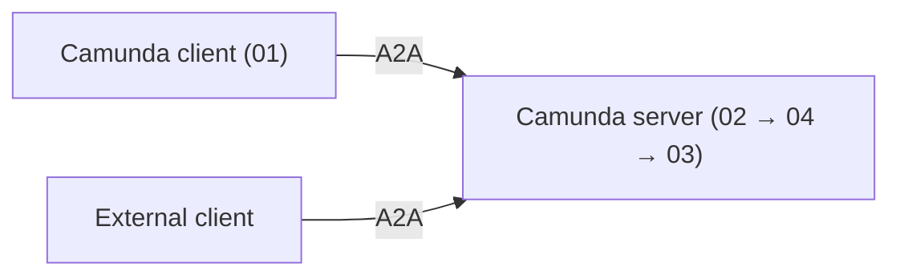

# A2A blueprint

Let your Camunda agents talk to other agents, and let other agents call yours, using the
[Agent2Agent (A2A)](https://a2a-protocol.org) protocol on Camunda 8.9 or later.

In this example, a client agent asks a server agent to run one tool, `upperCase`. The tool returns
the request data, an uppercased copy, and its length. Replace it with your own logic to build a real
A2A agent.

The server uses the standard webhook connector with two A2A element templates
(`.camunda/element-templates/`), so it runs on the released Camunda 8.9 connectors runtime. You don't
need a custom connector or job worker.

| Process                 | Role                                                                            |
| ----------------------- | ------------------------------------------------------------------------------- |
| `01` `a2a-client`       | Client agent. An AI agent that uses the **A2A Client connector** as its tool.   |
| `02` `a2a-rpc`          | A2A server endpoint. Camunda has no native A2A server connector, so this is BPMN. |
| `03` `a2a-server-agent` | Server agent. An AI agent with one tool, `upperCase`.                           |
| `04` `a2a-task`         | Tracks each task: its state, cancellation, and optional push notification.      |



## Before you start

Tested on Camunda 8 Run 8.9.27 (including the live end-to-end test below) and Java 21. The Maven scenarios in `test/` use
Camunda Process Test 8.9.8. This blueprint runs on a local [Camunda 8 Run (c8run)](https://docs.camunda.io/docs/self-managed/quickstart/developer-quickstart/c8run/)
cluster and is operated with [`c8ctl`](https://github.com/camunda/c8ctl). The local cluster needs no authentication, so there are no API clients, engine URLs or secrets to configure. All values are set in the BPMN files for localhost. The callback token is `local-dev-token`, so change it if you expose the cluster beyond your machine.

1. Install [Ollama](https://ollama.com) and pull a model that supports tool calling. The AI agents
   use it through Ollama's OpenAI-compatible API, so no API key or cloud account is needed. To use LM Studio instead, start its local server and change the endpoint (`http://localhost:1234/v1`) and model in the AI Agent tasks of `01` and `03`. The endpoint (`http://localhost:11434/v1`)
   and model (`llama3.1:8b`) are set in the AI Agent tasks of `01` and `03`. Change them there to use another model.

   ```bash
   ollama pull llama3.1:8b
   ```

2. Start a local cluster. The Orchestration Cluster API is on `http://localhost:8080` and the
   connectors runtime on `http://localhost:8086`.

   ```bash
   c8ctl cluster start 8.9
   ```

   c8run passes your shell environment to the connectors runtime. If `ZEEBE_*` or `CAMUNDA_*`
   variables for another cluster are set, unset them first, otherwise the connectors runtime cannot
   reach the local broker and the webhooks answer 503.

3. Deploy the server resources. The `Agent Card requested` start event in `02` already uses
   `http://localhost:8086/inbound/a2a` as its **Public RPC URL** (`inbound.publicRpcUrl`).

   ```bash
   c8ctl deploy 02-a2a-server.bpmn 03-server-agent.bpmn 04-a2a-task.bpmn server-request-validation.dmn
   ```

4. Open `http://localhost:8086/inbound/a2a-card` in a browser. You should see the Agent Card as JSON.

## Example 1: Camunda client, Camunda server

1. Deploy and start the client. It sends `demoInput` as `{"value": "Example input"}`.

   ```bash
   c8ctl deploy 01-client-agent.bpmn
   c8ctl create pi --id a2a-client
   ```

2. In Operate (`http://localhost:8080/operate`) or with `c8ctl list pi`, check that:
   - the client AI agent calls `sendMessage` (the A2A Client tool reads the Agent Card itself), which returns a submitted Task
     right away (it does not wait for the work);
   - the server side runs one `a2a-task` instance and one `a2a-server-agent` instance;
   - `Result callback received` completes when the server calls back, and the client reports
     `{"received": {"value": "Example input"}, "uppercase": "EXAMPLE INPUT", "length": 13}`.

## Example 2: external client, Camunda server

Any A2A client works. This example uses `curl` with an A2A 0.3 request. A2A 1.0 requests also work.

```bash
curl -s -X POST "http://localhost:8086/inbound/a2a" -H 'Content-Type: application/json' -d '{
  "jsonrpc": "2.0", "id": 1, "method": "message/send",
  "params": {"message": {
    "kind": "message", "messageId": "m1", "role": "user",
    "parts": [{"kind": "data", "data": {"demoInput": {"value": "Example input"}}}]
  }}
}'
```

The response is a Task whose `placeholder` artifact holds the same result as in Example 1. To fetch
the Task again, send `{"method": "tasks/get", "params": {"id": "<task id>"}}`.

Your client can send `demoInput` as a `data` part or as JSON in a `text` part. To try a full client,
use the Google ADK client in [`adk/`](adk/README.md) and point it at the Agent Card URL.

## How it works

- **Client (01).** `sendMessage` runs in `notification` mode. It returns the Task immediately and
  registers its callback URL (`http://localhost:8086/inbound/a2a-client-callback`) with a Bearer token. The *A2A Client Webhook* catch event
  (`Result callback received`) accepts only calls with that token, correlates on task id and
  notification token, ignores non-final states, and drops duplicate deliveries. If no callback
  arrives within 10 minutes, the tool call ends with a `timeout` result.
  The A2A Client connector itself works with any response pattern. This blueprint demonstrates only
  push notifications. If you connect the client to another A2A server, consult
  [A2A Client usage patterns](https://docs.camunda.io/docs/components/early-access/alpha/a2a-client/a2a-client-usage-patterns/)
  first: that server may need the blocking (synchronous) or polling BPMN flow instead, and the
  push-notification flow used here may not apply.
- **Server (02).** Validates the request, starts `a2a-task` (04), and waits for its settled signal
  (`a2a-settled:<taskId>:<rev>`). `SendMessage`, `GetTask`, and `CancelTask` answer from the settled
  Task.
- **Task (04).** Part of the one A2A server: it has no endpoint of its own and is started only by 02. Calls the server agent (03), maps failures and cancellations to the Task state, and
  builds the next Task revision. If the client sent a push configuration, it also POSTs the Task to
  that URL with the Bearer credentials and the notification token. Standalone push-configuration methods return `UNSUPPORTED_OPERATION`, so send the
  configuration inline in `SendMessage`.
- **Agent (03).** Reads `demoInput` from the request (from the data part, otherwise from JSON text)
  and passes it to `upperCase` through `fromAi()`.

**Messages and REST in `02`.** The A2A endpoint is a synchronous webhook: the HTTP
response is returned when the `02` instance completes, so that instance cannot be the long-running
task. A task must outlive the request, which a call activity cannot do, because the child instance
ends with its parent. So `02` starts `04` with a message throw event (`a2a-start`, correlation key =
task id) that triggers `04`'s message start event. `04` calls the server agent (`03`) as a call activity.

These things still use the Camunda REST API (local c8run needs no credentials), because BPMN has no
equivalent:
- Finding, reading and listing task instances (`GetTask`, `ListTasks`, and the lookup before cancel).
  Because a message start cannot set tags, these search by the `taskId` and `ctxTag` variables, so
  `a2a-task` instances no longer carry the `task-<id>` tag in Operate.
- Correlating cancel and follow-up messages. A throw event cannot have a boundary event for retries,
  and publish mode cannot report that nobody accepted the message, so `02` could not tell the caller
  the cancel failed. Verified on a live cluster: publish to a missing subscription is silently swallowed.
  Note that `04` has no `a2a-send` catcher, so follow-up messages are rejected, as before.

**A2A versions.** The Camunda client connector speaks A2A 0.3, so 02 serves both 0.3 and 1.0 on one
endpoint with one Agent Card. It converts requests to the 1.0 format and answers each caller, including
push notifications, in the caller's own version. In 0.3, `tasks/list`, streaming, and standalone
push-configuration methods are not supported.

## Contents

- `01-client-agent.bpmn`: client agent that uses the A2A Client connector.
- `02-a2a-server.bpmn`: the A2A server (`a2a-rpc`). It starts `04` with a message and uses the local Camunda REST API (no authentication) for searches and cancel/follow-up correlation.
- `03-server-agent.bpmn`: server agent with a placeholder script tool, `upperCase`.
- `04-a2a-task.bpmn`: per-task logic for the server (`a2a-task`).
- `server-request-validation.dmn`: checks that incoming requests are valid A2A requests.
- `.camunda/element-templates/`: the two A2A element templates (server endpoint and Agent Card).
  Camunda Desktop Modeler loads them from this folder. The HTTP JSON v13 and AI Agent v5 templates
  are built in, so they are not included.
- `test/`: Maven project that runs the scenarios with Camunda Process Test. The scenarios are in
  `test/src/test/resources/scenarios/`, one `NN-name.test.json` per process (`01` to `04`). `01` has
  the Example 1 end-to-end scenario, and `02` has the Example 2 scenario. They mock connectors and
  use time control, so they run headless. `FeelCasesTest` covers the FEEL outcome mapping in `04`.
- `adk/`: an external A2A agent built with Google ADK, used to check interoperability.

## Run the tests

```bash
mvn test -f test/pom.xml                      # Camunda Process Test: 50 tests, no cluster or LLM needed
mvn test -f test/pom.xml -Pe2e                # one real run: c8run + Ollama, no mocks (see below)
cd adk && .venv/bin/python -m pytest          # offline ADK interop tests (see adk/README.md)
```

**End-to-end test (`-Pe2e`, not in CI).** `E2eHappyPathTest` deploys the five resources to the
cluster on `http://localhost:8080` (plain REST, ignores `CAMUNDA_*` env vars), starts `01`, and
waits for it to finish. It asserts only that each stage happened: a `02` and a `04` instance, and the `Result callback received` event. It never asserts LLM text.
Needs `c8ctl cluster start` and `ollama pull llama3.1:8b`. It skips with a message if the cluster
or Ollama is unreachable. Use a cluster where no older process owns the `a2a-card` webhook path,
otherwise the card endpoint answers with the older process's error.

Live-cluster notes (verified on 8.9.27): The `Remote A2A agent` tool uses the base URL
`http://localhost:8086/inbound/` (trailing slash required) plus `agentCardLocation` `a2a-card`. The tool fetches the card itself when the agent starts. The tool is pinned to `sendMessage`, and `"null"` strings that small models put
in optional parameters are turned into real nulls. The card endpoint reads its properties from
`correlation.activatedElement.delegate.properties` when present.

The Maven suite runs in CI (`test-suites.yml`). The ADK tests do not. Camunda Process Test reports
process coverage per class. The server (`a2a-rpc`) misses the webhook start events (`RpcReceived`,
`CardRequested`), which scenarios cannot use as start instructions.

This solution has no forms. Deploy only one server profile.

## Customization

To build your own agent, replace `upperCase` in `03` with your own logic. `04` returns the tool
result as the `placeholder` artifact, so update it there if your result has a different shape. Also
update the name, description, and skills in the Agent Card on `02`.

## Known gaps

- Callback authentication, duplicate suppression and non-final-state filtering are enforced by the
  inbound connector, so Camunda Process Test can't exercise them. The tests cover correlation,
  duplicate delivery after completion, the timeout, and the server's authenticated push request.
  Push retries stop at the HTTP connector's three attempts.
- The Maven suite takes just under two minutes. Each test costs about two seconds of engine data reset, and timers use `INCREASE_TIME`, so there is no real waiting.
- The A2A Client connector can't run in Camunda Process Test. The Example 1 scenario completes its
  jobs with mocked results. The Example 2 scenario runs 02, 03, and 04 together.
- Every agent and connector response is mocked or scripted in the Maven suite. No test checks real
  LLM behavior, the real A2A Client or inbound connectors, or the Agent Card endpoint, except the
  opt-in `-Pe2e` test above.
- The ADK interop tests run only locally, not in CI, and the Camunda-server variant needs
  `CAMUNDA_CARD_URL` pointing at a live deployment.
- Process 01 can't resume a multi-turn conversation (a Task in the `input-required` state).
